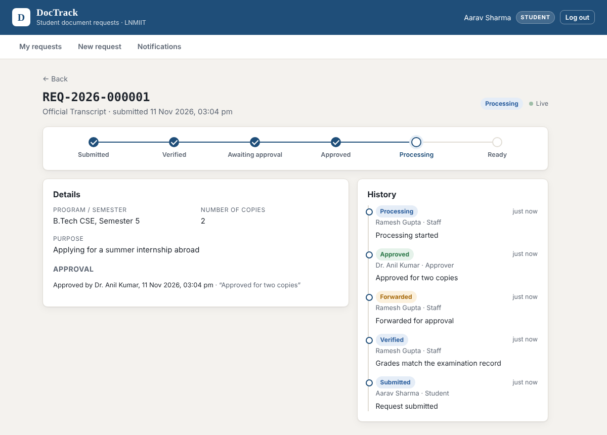
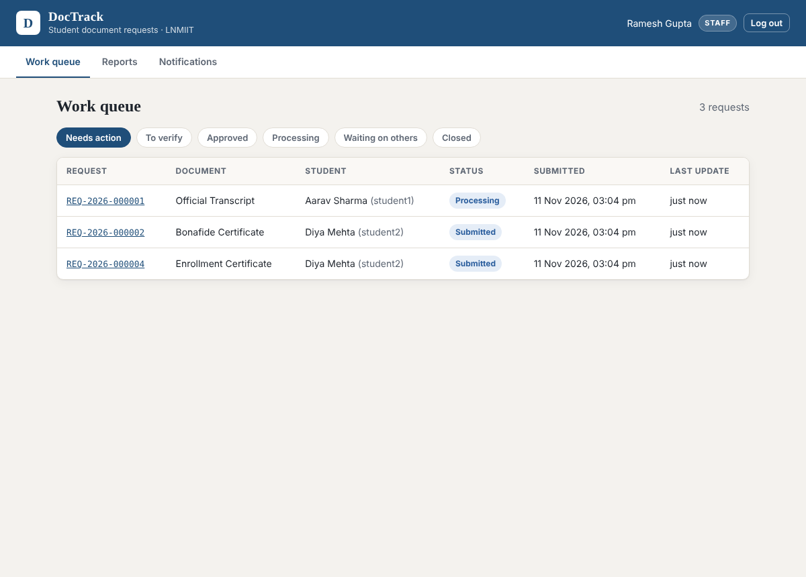
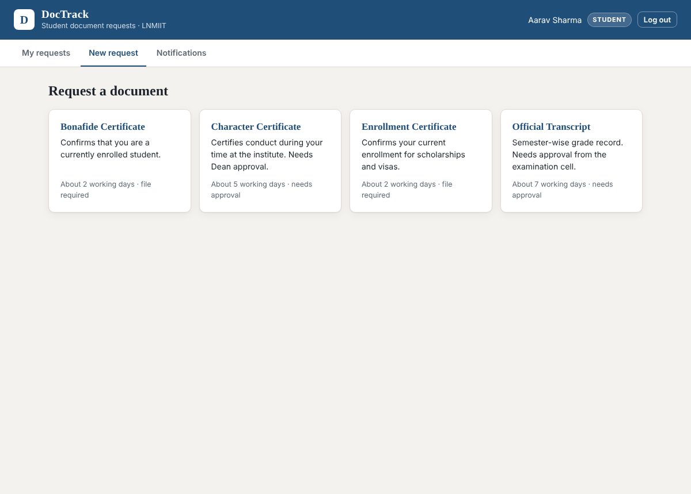
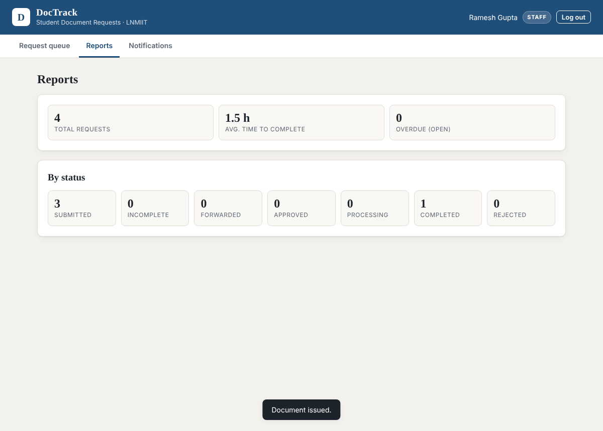
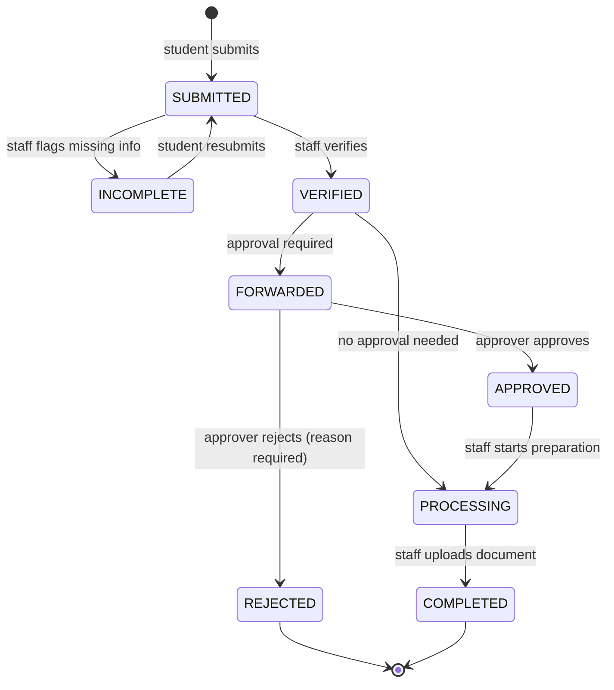

# DocTrack: Student Document Request and Tracking System

[](https://github.com/vaidehikh-2028/doctrack/actions/workflows/ci.yml)

**Live demo:** https://doctrack-j8z1.onrender.com (login: `student1`, `staff1`, `approver1` or `admin1`, password `Demo@1234`; the free server may take ~1 minute to wake up)

| Request detail with history | Staff work queue |
|---|---|
|  |  |
| **New request (student)** | **Reports** |
|  |  |

A role-based web application for requesting, verifying, approving and delivering official student
documents (Bonafide, Character Certificate, Transcript, ...) at LNMIIT. Students submit requests
online and track them; document staff verify them; an approving authority approves or rejects
where needed; the student downloads the issued document.

Built from the CS311/CS314 design documents (SRS, use cases, state diagrams, class model, interface
design and test plan): every status rule, error code and test case below traces back to them.

**Stack:** Java 17 · Spring Boot 3.3 · Spring Security (JWT) · Spring Data JPA · PostgreSQL / H2 ·
AWS S3 · React 18 · Vite · JUnit 5 · MockMvc · Vitest · Testing Library · Docker · GitHub Actions

---

## Features

| Role | Can do |
|---|---|
| Student | Browse offered document types, submit with fields and a supporting file, track status and full history, resubmit when marked Incomplete, download the issued document, see notifications |
| Document staff | Work queue (oldest first), verify or mark Incomplete with the missing information, start processing after approval, upload the issued document |
| Approving authority | Pending approvals, approve with comments or reject with a mandatory reason, decision history |
| Administrator | Manage users and roles, activate/deactivate accounts, configure document types (required fields, attachment, approval), reports |

Also included: notification outbox with retries, SLA escalation for requests stuck more than 48 hours,
and an audit trail of every status change.

## Request lifecycle

The state machine from the Assignment 5 state diagram is enforced in one place
(`RequestStatus` + `DocumentRequest.transitionTo`). Any other transition is refused with `E-VER-001`.



## Architecture

```mermaid
flowchart LR
    UI[React SPA<br/>Vite build, served by Spring] -->|REST + JWT| WEB[web<br/>controllers, error mapping]
    WEB --> SVC[service<br/>RequestService · VerificationService<br/>ApprovalService · AdminService]
    SVC --> DOM[domain + model<br/>state machine, validator, entities]
    SVC --> REPO[repository<br/>Spring Data JPA]
    SVC --> STO[storage<br/>FileStorage]
    SVC --> NTF[notification<br/>outbox]
    REPO --> DB[(PostgreSQL / H2)]
    STO --> S3[(Amazon S3 / local disk)]
    JOBS[jobs<br/>@Scheduled] --> NTF
    JOBS --> SLA[SlaEscalationService]
    NTF -->|dispatcher with retry| GW[Email gateway]
```

Layering follows the Assignment 6 architecture: controllers never touch repositories, and the
`domain` package (state machine, validation rules, error catalogue) has no framework dependencies,
so it is unit-tested in isolation.

## Design decisions worth discussing

- **One place for the state machine.** `RequestStatus` holds the allowed-transition map;
  `DocumentRequest.transitionTo()` is the only way to change status and always appends a
  `StatusHistory` row. A rejected request can never reach document generation (BR-006).
- **Optimistic locking for concurrent staff actions.** `DocumentRequest` and `Approval` carry
  `@Version`. If two staff members verify the same request at the same moment, exactly one commit
  succeeds and the other gets `E-SYS-409`. This is tested with real threads (`ConcurrentVerificationTest`).
- **Transactional outbox for notifications.** Notifications are rows written in the same
  transaction as the status change. A scheduled dispatcher sends them and retries failures with
  exponential backoff (30 s, 60 s, 120 s, ...). An email outage can never roll back or lose a request.
- **Files in S3, metadata in the database.** Uploads go to a private, encrypted bucket. Downloads
  stream through the API so ownership rules are always checked (only the requesting student can
  download the issued document, BR-009).
- **Defence in depth on uploads.** Extension and size are checked, and so are the file's magic bytes,
  so `setup.exe` renamed to `setup.pdf` is refused.
- **No information leaks.** Login failures return one generic message (FR-002), and a password hash
  is checked even for unknown users so response time does not reveal valid user IDs. A request the user may not see returns 404, not 403, so its existence is not revealed.
- **Document types are data, not code.** Admins add types and required fields without a deploy (NFR-012).
- **Testable time.** Jobs take `Instant now` as a parameter and services use an injected `Clock`,
  so SLA and retry behaviour are tested deterministically.

## Running locally

Requirements: JDK 17+ and Maven 3.9+ (or open the folder in IntelliJ IDEA, which bundles Maven).

```bash
cd frontend && npm ci && npm run build && cd ..   # builds the React UI into src/main/resources/static
mvn spring-boot:run
# open http://localhost:8080
```

Working on the UI? Run the backend as above, then `cd frontend && npm run dev` and open
http://localhost:5173: Vite hot-reloads the React app and proxies `/api` to port 8080.

The default profile uses an H2 file database in `./data` and stores files in `./data/files`.
Demo accounts are seeded on first start, all with password `Demo@1234`:

| User | Role |
|---|---|
| `student1`, `student2` | Student |
| `staff1`, `staff2` | Document staff |
| `approver1`, `approver2` | Approving authority |
| `admin1` | Administrator |

Production-like stack with PostgreSQL:

```bash
docker compose up --build
```

## Tests

```bash
mvn verify          # runs all tests and writes a coverage report to target/site/jacoco/index.html

cd frontend
npm test            # unit and component tests (Vitest + Testing Library)
npm run test:e2e    # full-stack: the React UI driving a running backend (mvn spring-boot:run first)
```

The end-to-end suite renders the real React app in jsdom against the live API and walks every role
through the lifecycle: submit, verify, approve, process, upload and download; incomplete and
resubmit; rejection with a mandatory reason; and a renamed `.exe` blocked before upload.
CI runs it against the freshly built jar on every push.

All 24 test cases from the Assignment 8 test plan are automated, plus extra cases for business rules
the plan did not cover.

| Test case | What it checks | Test |
|---|---|---|
| TC-01 | Valid Bonafide submission, ID format `REQ-YYYY-NNNNNN` | `SubmitRequestTest.tc01_validSubmission` |
| TC-02 | Empty mandatory field → `E-REQ-001`, nothing created | `SubmitRequestTest.tc02_*`, `RequestValidatorTest.tc02_*` |
| TC-03 / TC-04 | Purpose 250 chars accepted / 251 refused (BVA) | `SubmitRequestTest.tc03_*`, `tc04_*` |
| TC-05 / TC-06 | Attachment exactly 5 MB accepted / 5 MB + 1 KB refused (BVA) | `SubmitRequestTest.tc05_*`, `tc06_*` |
| TC-07 | `.exe` and missing file → `E-REQ-003` | `SubmitRequestTest.tc07_*` |
| TC-08 | Type withdrawn by admin mid-form → `E-REQ-002` | `SubmitRequestTest.tc08_*` |
| TC-09 | Unique IDs, first history entry, confirmation notification; gateway failure keeps the request | `SubmitRequestTest.tc09_*`, `NotificationDispatchTest` |
| TC-10 | Verify without approval → Processing, no Approval row | `VerifyAndApproveTest.tc10_*` |
| TC-11 | Verify with approval → Forwarded + Pending Approval | `VerifyAndApproveTest.tc11_*` |
| TC-12 / TC-13 | Incomplete with info / without info → `E-VER-002` | `VerifyAndApproveTest.tc12_*`, `tc13_*` |
| TC-14 | Second verifier refused, no duplicates (sequential and real threads) | `VerifyAndApproveTest.tc14_*`, `ConcurrentVerificationTest` |
| TC-15 | Student cannot reach staff functions → `E-AUTH-403` | `VerifyAndApproveTest.tc15_*` |
| TC-16 / TC-17 | Approve / reject with reason, notifications | `VerifyAndApproveTest.tc16_*`, `tc17_*` |
| TC-18 / TC-19 | Blank reason → `E-APR-002` / 1-char reason accepted (BVA) | `VerifyAndApproveTest.tc18_*`, `tc19_*` |
| TC-20 | Second decision → `E-APR-001` | `VerifyAndApproveTest.tc20_*` |
| TC-21 | Rejected request cannot be processed or completed | `VerifyAndApproveTest.tc21_*` |
| TC-22 | Valid and invalid login, one generic message | `SystemTest.tc22_login` |
| TC-23 | No access without login; expired session → `E-AUTH-440` | `SystemTest.tc23_*` |
| TC-24 | End-to-end lifecycle through download | `SystemTest.tc24_endToEnd` |
| BR-008, BR-009, NFR-013 | Students see only their own requests; only the student downloads the issued document; approvers see only forwarded requests | `SubmitRequestTest.br008_*`, `SystemTest.tc24_*`, `VerifyAndApproveTest.approverSeesOnlyForwarded` |
| SLA, retries, admin | Escalation after 48 h (once per stage), backoff and max attempts, user management, reports | `SystemTest`, `NotificationDispatchTest` |

## REST API

All endpoints except login take `Authorization: Bearer <token>`. Errors share one shape:
`{"code": "E-REQ-001", "message": "...", "fieldErrors": [{"field": "...", "message": "..."}], "timestamp": "..."}`.

| Method | Path | Role | Purpose |
|---|---|---|---|
| POST | `/api/auth/login` | public | Log in with user ID or email → JWT |
| GET | `/api/document-types` | any | Offered document types |
| POST | `/api/requests` (multipart) | Student | Submit: `documentTypeId`, `purpose`, `fields` (JSON), `file` |
| POST | `/api/requests/{no}/resubmit` (multipart) | Student | Resubmit an Incomplete request |
| GET | `/api/requests/mine` | Student | My requests |
| GET | `/api/requests/{no}` | involved users | Detail with history, approvals and files |
| GET | `/api/requests/{no}/files/{id}` | involved users | Download attachment / issued document |
| GET | `/api/notifications/mine` | any | My notifications |
| GET | `/api/staff/requests?status=...` | Staff | Work queue |
| POST | `/api/staff/requests/{no}/verify` | Staff | `{"outcome":"VERIFIED"\|"INCOMPLETE","missingInfo","remarks"}` |
| POST | `/api/staff/requests/{no}/start-processing` | Staff | Approved → Processing |
| POST | `/api/staff/requests/{no}/complete` (multipart) | Staff | Upload issued document → Completed |
| GET | `/api/approvals/pending` | Approver | Requests awaiting a decision |
| POST | `/api/approvals/{no}/decision` | Approver | `{"decision":"APPROVED"\|"REJECTED","reason","comments"}` |
| GET | `/api/approvals/history` | Approver | My past decisions |
| GET/POST/PATCH | `/api/admin/users[/{id}]` | Admin | Manage users and roles |
| GET/POST/PUT | `/api/admin/document-types[/{id}]` | Admin | Manage document types |
| GET | `/api/reports/summary` | Staff, Admin | Counts by status, average completion time, overdue |

## Deploying on AWS (free tier)

1. **S3:** create a private bucket (block all public access, default encryption on).
2. **IAM:** create a role for EC2 allowing `s3:GetObject`, `s3:PutObject` and `s3:DeleteObject` on that bucket only.
3. **Database:** RDS PostgreSQL `db.t4g.micro`, or PostgreSQL in Docker on the same instance.
4. **EC2:** launch a `t3.micro`/`t4g.micro` with the IAM role, install Docker, then build and run:
   ```bash
   docker build -t docreq .
   docker run -d -p 80:8080 \
     -e SPRING_PROFILES_ACTIVE=prod \
     -e DB_URL=jdbc:postgresql://<host>:5432/docreq -e DB_USERNAME=... -e DB_PASSWORD=... \
     -e APP_JWT_SECRET=$(openssl rand -base64 48) \
     -e S3_BUCKET=<bucket> -e AWS_REGION=ap-south-1 \
     docreq
   ```
5. Put HTTPS in front (an Application Load Balancer with an ACM certificate, or Caddy/Nginx on the instance).
6. Set an AWS billing alarm.

## Project layout

```
src/main/java/com/lnmiit/docreq
├── domain/        state machine, validation rules, error catalogue (no framework code)
├── model/         JPA entities
├── repository/    Spring Data repositories
├── service/       use-case workflows (UC-005, UC-008, UC-011, admin, SLA)
├── notification/  outbox, dispatcher with retry, gateway
├── storage/       S3 and local file storage
├── security/      JWT issue/verify, filter, access rules
├── jobs/          scheduled jobs
├── web/           REST controllers, DTOs, error mapping
└── config/        clock, scheduling, demo data

frontend/src
├── api/           fetch client (JWT, timeouts, error catalogue), XHR uploads with progress
├── auth/          AuthProvider: token restore via /api/auth/me, sign-out at token expiry
├── components/    status stepper, role-aware action panel, request forms
├── pages/         one page per screen and role
└── test/          end-to-end suite against the running API
```

## Operations: log triage

The app writes two logs to `logs/` (override with `LOG_DIR`): a Tomcat access log with one line
per request and its latency, and the application log, where every handled API error is one line:
`E-REQ-001 400 POST /api/requests user=7 Please complete the highlighted fields.`

`ops/logscan.sh` turns them into a triage report using standard Unix tools (Bash, awk, sort):

```bash
ops/logscan.sh logs/access*.log logs/docreq.log           # error codes, slowest endpoints, status mix, exceptions
ops/logscan.sh --since "2026-11-11 09:00" logs/*.log      # a time window
docker logs doctrack 2>&1 | ops/logscan.sh -              # from stdin; .gz files also work
ops/logscan.sh --max-5xx-rate 1 --max-p95-ms 500 logs/*.log  # exit 2 when a threshold is breached
ops/logscan.sh --follow logs/access.log logs/docreq.log   # live: 5xx, slow requests and errors as they happen
```

Endpoints are grouped by route (`REQ-2026-000123` becomes `{requestNumber}`), and p50/p95 are exact
nearest-rank percentiles. CI runs it over the end-to-end and load-test traffic, publishes the report
in the job summary, and fails the build on any 5xx or unexpected application ERROR. Its first run
found one: client disconnects during the load test were being logged as `E-SYS-500` server errors. The script has its own test suite
(`ops/test/logscan.test.sh`) and is checked with `shellcheck`.

## Frontend notes

- **Same origin, no CORS.** Vite builds into `src/main/resources/static`, so Spring serves the UI
  and the API from one origin and one deployment.
- **Role-aware UI over role-enforced API.** Each screen shows only the actions the backend's state
  machine and `@PreAuthorize` rules allow, but the server remains the only authority.
- **Concurrency surfaced, not hidden.** When a staff action loses an optimistic-lock race
  (`E-SYS-409`) or someone else already acted (`E-VER-001`, `E-APR-001`), the UI reloads the request
  and says so instead of showing a generic error.
- **Live status without websockets.** Detail and queue pages poll while the tab is visible and pause
  when it is hidden (Page Visibility API), which also avoids waking the free-tier server needlessly.
- **Uploads checked twice.** The browser checks extension, size and magic bytes before uploading
  (with an XHR progress bar); the server checks them again.

## Possible next steps

- Flyway migrations instead of `ddl-auto=update`
- AWS SES gateway for real email delivery
- Pagination and search on staff queues
- PDF generation of certificates from templates
